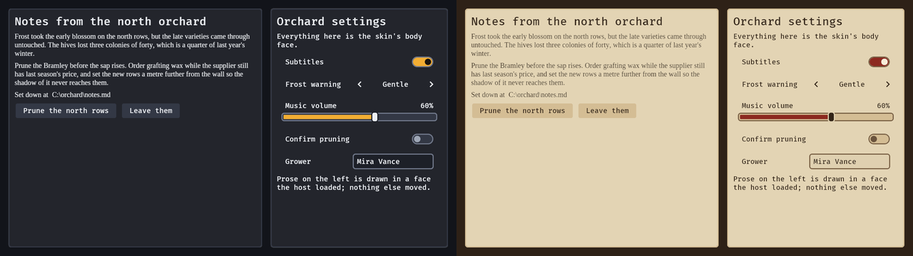

# bevy_gooey

> ⚠️ **Vibe Coded.** Written by AI agents working from a human's direction, covered by tests rather than a line-by-line human review. Read the code before you rely on it for something you care about.

Game and tool interfaces for Bevy 0.20: a skin, ready-made widgets and keyboard and gamepad navigation, built on Bevy's own headless widgets (the behaviour with no look of its own).

[](https://crates.io/crates/bevy_gooey)
[](https://docs.rs/bevy_gooey)
[](https://github.com/dark-incorporated/bevy_gooey/actions/workflows/ci.yml)
[](https://bevyengine.org)
[](#who-and-licence)


*`examples/gallery`: two panels, a meter draining, settings in tabs, a list that scrolls to follow focus with a field to name a save under it, a toast, and the Select and Back legend in the corner.*

**Status:** usable · Bevy 0.20 · MSRV 1.97.1

**Why:** Bevy gives you layout and picking but no skin, no focus ring a pad player can follow and no ready-made options row, so every game rebuilds the same menu. `bevy_gooey` shares one crate's worth of it, checks it against WCAG 2.2 (the Web Content Accessibility Guidelines' contrast and target-size rules) and keeps the look as data you can edit.

## Quick start

```sh
cargo add bevy_gooey
```

```rust
use bevy::prelude::*;
use bevy_gooey::*;

fn main() {
    App::new()
        .add_plugins((DefaultPlugins, GooeyPlugins))
        .add_systems(Startup, setup)
        .run();
}

fn setup(mut commands: Commands) {
    commands.spawn(Camera2d);
    commands.spawn((
        screen(),
        children![(
            panel(),
            children![
                heading("Paused"),
                (
                    menu(),
                    children![
                        (button("Resume"), observe(|_: On<Activate>| info!("resume"))),
                        button("Quit"),
                    ]
                ),
            ]
        )],
    ));
}
```

Every widget composes inside `children![]`, and a button acts through an `Activate` observer. The last release is older than `main`: the code editor, the Markdown view and the layout parts (`scroll_region`, `scroll_viewport`, `Shown`, `Sizing` and the rest of [the layout page](https://github.com/dark-incorporated/bevy_gooey/blob/main/docs/guide/layout.md)) are only on `main`, so for them depend on git:

```toml
[dependencies]
bevy_gooey = { git = "https://github.com/dark-incorporated/bevy_gooey" }
```

Features, all off by default: `serde` (save and load a `GooeySkin` and `UiScaleSettings` as data), `reflect` (`inspector(..)`), `markdown` (`markdown_view(..)`, one dependency, `pulldown-cmark`) and `testing` (`bevy_gooey::testing`: find a widget by its label, click it and type in a headless test).

## Try it

```sh
cargo run --example gallery
```

Every widget on one screen, what the picture above shows. Arrows or the D-pad move focus, and Enter, Space or South activate. Shift+T turns the text up 1.5 times, Options swaps the skin, and Quit opens a dialog that holds focus. Right on a focused tab or Ctrl+PageDown turns the settings page. The Controls page has two rebinding rows (Enter on Jump, then a key). The Save as field takes a name: click it or Tab to it, type, Enter saves and Up leaves it. The save-slot list scrolls with the wheel, a drag on its thumb, or PageUp and PageDown. `cargo run --example options` is the player's options on a screen of their own, and [`examples/`](https://github.com/dark-incorporated/bevy_gooey/tree/main/examples) has one example per widget family.


*The still: the dark skin, 1280 × 720.*

## What you can do

- **Skin the whole interface from one value.** `GooeySkin` is plain data with four presets (dark, parchment, high contrast held to 7:1, and a compact `Tool` look), a `problems()` check, design tokens and a `SkinScope` that restyles one subtree ([skins](https://github.com/dark-incorporated/bevy_gooey/blob/main/docs/guide/skins.md)).

  

  *Theme: `skin_preset("Theme")` steps the whole screen through the presets in one frame, and the player's text size stays.*
- **Give one kind of text its own face.** `TextFace::new(handle)` on a text pins the face — a page of prose in a reading serif, a plate count in a condensed one — where `GooeyFonts` gives labels and headings theirs. The role still sets the ink and the size, your weight and slant stay, it is per node (no cascade into a Markdown page or a code editor), and taking it off gives the role's face back in the same frame ([text face](https://github.com/dark-incorporated/bevy_gooey/blob/main/docs/guide/text-face.md)).

  

  *`TextFace`: the prose on the left is drawn in a face the game loaded, and nothing else moved.*

- **Style by class, from a sheet you edit live.** `StyleClass::of("card")` on a node and a `StyleSheet` of rules (`.card`, `.list .row:hover`, read from YAML or any serde format) write its padding, size, shape, colours and z, with CSS's specificity; replace the sheet and everything restyles that frame, and `explain` says which rule styled a node ([style sheets](https://github.com/dark-incorporated/bevy_gooey/blob/main/docs/guide/style-sheets.md)).
- **Build a settings screen with one line a row.** `toggle`, `choice`, `slider`, `binding` (rebind a key or pad button), `text_input`, `number_field`, `color_field`, `tabs` and the player's own `text_size`, `interface_size`, `pad_style` and `skin_preset` rows ([controls](https://github.com/dark-incorporated/bevy_gooey/blob/main/docs/guide/controls.md), [player options](https://github.com/dark-incorporated/bevy_gooey/blob/main/docs/guide/options.md)).
- **Draw a HUD a player can read.** `meter` fills in the skin's accent; `MeterTone("health")` paints a bar in a tone of the skin (`GooeySkin::tones`), so health, mana and stamina are told apart and a player's palette is one skin change, and `MeterSegments(12)` cuts a bar into cells so "7 of 12" shows without a number ([the guide](https://github.com/dark-incorporated/bevy_gooey/blob/main/docs/guide/widgets.md), `examples/hud.rs`).

  

- **Name a thing with a plate.** `tag("ELITE")` is a read-only word on a plate and `TagTone("danger")` colours it from the skin, so a name plate, a "NEW" mark or a level pill reads in any skin ([the guide](https://github.com/dark-incorporated/bevy_gooey/blob/main/docs/guide/tags.md), `examples/tags.rs`).

  

- **Show a lot of data and arrange a workbench.** `table` and `tree` hold ten thousand rows in a dozen entities, `list` scrolls with a rail, and `split`, `dock`, `card_grid`, `slot_grid` and drag and drop arrange them ([lists](https://github.com/dark-incorporated/bevy_gooey/blob/main/docs/guide/lists.md), [docks](https://github.com/dark-incorporated/bevy_gooey/blob/main/docs/guide/docks.md), [drag and drop](https://github.com/dark-incorporated/bevy_gooey/blob/main/docs/guide/drag-drop.md)). A table column can `.wrap()` its text and the table still windows on what each row measured, so ten thousand wrapped rows cost a viewport of entities ([a wrapping inventory](https://raw.githubusercontent.com/dark-incorporated/bevy_gooey/main/docs/media/table-wrap.gif)); a split takes a `SplitThickness` and an `led` a `LedSize` ([the knobs on one screen](https://raw.githubusercontent.com/dark-incorporated/bevy_gooey/main/docs/media/host_knobs.png)).
- **Give a tool its chrome.** `menu_bar`, `command_palette`, `context_menu`, `toolbar`, `status_bar`, `chip` (a tag that wraps inside its row; `quiet_chip` keeps focus off it), `inspector` (the rows of a reflected component), `code_editor` (`CodeSoftWrap` wraps it at its edge, `CodeMinimap` draws the file's outline beside it, `CodeMarkdown` draws Markdown in the skin's inks, `GooeySkin::syntax_theme` picks the hues: [the code editor](https://github.com/dark-incorporated/bevy_gooey/blob/main/docs/guide/code-editor.md)) and `markdown_view` ([the command palette](https://github.com/dark-incorporated/bevy_gooey/blob/main/docs/guide/command-palette.md), [menus](https://github.com/dark-incorporated/bevy_gooey/blob/main/docs/guide/menus.md), [inspector](https://github.com/dark-incorporated/bevy_gooey/blob/main/docs/guide/inspector.md)).

  

  *The command palette: `CommandList` holds the commands, `command_palette()` is the modal, and a command that is off says why and runs nothing.*
- **Reach every screen with keys or a pad.** Arrows and the D-pad move focus, an open dialog holds it, Escape or the pad's B is one `Cancel`, `FocusRegion`s let F6 walk a tool's parts, `prompts()` shows the keys in the words of the device last used, and a screen reader is told every widget's role, name and state ([navigation](https://github.com/dark-incorporated/bevy_gooey/blob/main/docs/guide/navigation.md), [accessibility](https://github.com/dark-incorporated/bevy_gooey/blob/main/docs/guide/accessibility.md)).
- **Say something without building a layout.** `commands.spawn(toast("Game saved"))` stacks, times itself, merges repeats and can carry an `Undo` button, and `notification_center()` lists the journal with a button on a row for each of its actions ([toasts](https://github.com/dark-incorporated/bevy_gooey/blob/main/docs/guide/toasts.md)).

  

  *Toast actions and the notification centre: a toast and its journal row are one entry, and a press on a row's button sends one `NotificationAction`.*
- **Lay a tool's panels out from the skin's own steps.** `row`, `column`, `scroll_region`, `scroll_viewport`, `Shown`, `Sizing`, `Spacing` and the rest build a panel with no `Node` literal in the caller, so a theme or a text size moves all of it ([layout](https://github.com/dark-incorporated/bevy_gooey/blob/main/docs/guide/layout.md)).

  

  *Scroll regions: `cargo run --example scroll`. Page and Home keys move focus and the column follows; a slider keeps its own Home and End.*

[`docs/guide/catalogue.md`](https://github.com/dark-incorporated/bevy_gooey/blob/main/docs/guide/catalogue.md) lists every part by the job it does, and [`docs/gallery.md`](https://github.com/dark-incorporated/bevy_gooey/blob/main/docs/gallery.md) holds the rest of the pictures.

## Part of Dark Inc.

`bevy_gooey` is one of the [Dark Inc.](https://github.com/dark-incorporated) crates: the family table there says which crate owns what, so two of them never both own the interface. The Dark Factory, Dark Inc.'s level editor, builds its own interface on it, and [the book's page for the crate](https://dark-incorporated.github.io/crates/bevy_gooey.html) says how a project's skin reaches it.

## Bevy compatibility

| `bevy_gooey` | Bevy |
|---|---|
| 0.1 – 0.64.0 and `main` | 0.20 |

## Learn more

- [docs.rs](https://docs.rs/bevy_gooey): the API reference (`cargo doc --open`); [the book page](https://dark-incorporated.github.io/crates/bevy_gooey.html).
- [`docs/guide/`](https://github.com/dark-incorporated/bevy_gooey/blob/main/docs/guide/README.md): one page per subject, [upgrading](https://github.com/dark-incorporated/bevy_gooey/blob/main/docs/guide/upgrading.md) (what a host changes when a release breaks), [testing a gooey UI](https://github.com/dark-incorporated/bevy_gooey/blob/main/docs/guide/testing.md), and [what a host touches](https://github.com/dark-incorporated/bevy_gooey/blob/main/docs/guide/host-api.md).
- [`docs/gallery.md`](https://github.com/dark-incorporated/bevy_gooey/blob/main/docs/gallery.md) and [`docs/media/README.md`](https://github.com/dark-incorporated/bevy_gooey/blob/main/docs/media/README.md): the pictures, and the command that makes each.
- [`examples/`](https://github.com/dark-incorporated/bevy_gooey/tree/main/examples): `gallery` and one example per widget family.
- [`docs/research/`](https://github.com/dark-incorporated/bevy_gooey/tree/main/docs/research): the reading lists and measurements behind the design.
- [`CHANGELOG.md`](https://github.com/dark-incorporated/bevy_gooey/blob/main/CHANGELOG.md): what each release changed, and what it broke.

## Who and licence

Maintainer [@Ladvien](https://github.com/Ladvien). Questions and bugs go to [the issues](https://github.com/dark-incorporated/bevy_gooey/issues), and a game asking for a change here uses the `consumer` label. Contributions follow the org's [`CONTRIBUTING.md`](https://github.com/dark-incorporated/.github/blob/main/CONTRIBUTING.md); the crate's own rules for changing it are in [`AGENTS.md`](https://github.com/dark-incorporated/bevy_gooey/blob/main/AGENTS.md).

MIT OR Apache-2.0, at your option.
