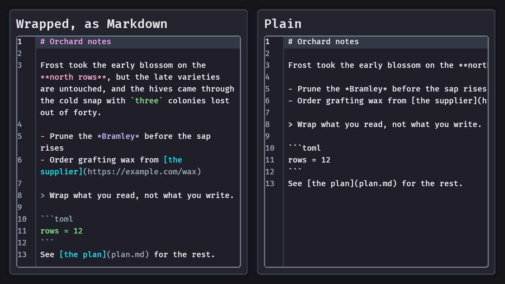

# Code editor

`code_editor(label, text)` is a code editor that fills the room its host leaves: a line-number gutter, the current line lit, a caret that travels on a spring, a selection by keyboard and pointer, undo, a clipboard and a view that glides. It is the file editor of a tool, not a form field (that is [`text_area`](text-input.md#a-text-area)).

```rust
commands.spawn((
    code_editor("Scene script", "let speed = 3;\n"),
    CodeIndentation { indent: CodeIndent::Spaces(2), tab_width: 4 },
    observe(|change: On<ValueChange<String>>| {
        if change.is_final {
            // Ctrl+S or Cmd+S: save change.value.
        }
    }),
));
```

Give the editor a host with a size (a column with a height, a split pane, a dock panel): it grows into what the host leaves, never under a few lines.

## The text

- **`CodeEditorValue`** on the editor is the host's copy: `text()` is the text, `revision()` moves with every change, the player's and the host's alike. Replace the text with `set`:

  ```rust
  fn reload(mut editors: Query<&mut CodeEditorValue>) {
      for mut value in &mut editors {
          value.set("brand new text");
      }
  }
  ```

  The editor shows it the same frame, with no event, and its undo history starts over: the text under it changed without the player. (`CodeEditorValue::set` is the one write; a direct field write is not possible.)
- **`ValueChange<String>`** is sent for every edit, with the whole text. `is_final` is true for **Cmd or Ctrl+S**, sent even if nothing changed since the last one, so a save is always one event. A caret move sends nothing.
- **`CodeEditor::buffer()`** reads the caret (`caret()`), the selection (`selection()`, `selected_text()`) and the lines (`line(i)`, `len_lines()`); `CodeEditor::select` and `scroll_to_line` move them.
- The engine-free text is **`CodeBuffer`**, usable without an app: lines keep their own `\n` or `\r\n` (CRLF files are written back byte for byte), a column is a byte offset (`CodePos`), `offset_of` and `pos_at` turn it into an offset in the whole text, and `replace_ranges` is a replace-all as one undo step.

## Keys

| Key | Does |
|---|---|
| characters | type (over a selection, replace it) |
| Enter | a new line carrying the line's indent |
| Backspace, Delete | a character; with Ctrl or Alt, a word |
| Left, Right | a character; with Ctrl or Alt a word; with Cmd the line's start or end |
| Up, Down | a line, keeping the column the caret last stood at; with Cmd the text's start or end |
| Home, End | the line's first non-blank (again: its start), the line's end; with Ctrl the text's ends |
| Page Up, Page Down | a page |
| Shift with any of them | extend the selection |
| Tab, Shift+Tab | indent, outdent: `CodeIndentation` says with spaces to the next stop or a tab character; several selected lines are all indented |
| Ctrl or Cmd with A, C, X, V | select all, copy, cut, paste |
| Ctrl or Cmd with Z, Shift+Z or Y | undo, redo |
| Ctrl or Cmd with S | a final `ValueChange<String>` |
| Escape | give focus up |

A **double-click** selects the word under the pointer and a **triple-click** the line (a drag after either selects by that unit). The **wheel** scrolls and the view glides to where it is asked.

**Undo** groups what was typed: a run of one kind of character (letters and digits, blanks, anything else) within a second of the last one is one step, so "foo bar" undoes as `bar`, a space and `foo`. A caret move ends a run. A paste, a cut, a new line, an indent, a word delete and a replace-all are a step of their own. A paste of three lines is one undo.

## Not a trap

Tab is the editor's (it indents), so **Escape gives focus up**, F6 and Shift+F6 move between regions as everywhere, and a pad's D-pad moves focus on (a pad has no caret). The editor is a [`FocusRegion::host()`](focus-regions.md), so the arrow keys are its own while it has focus. While it has focus it carries [`TextEditing`](text-input.md), so a game's hotkeys behind `not(is_text_editing)` wait.

## Looks and feel

- The face is **`GooeyFonts::mono`**: one column per character. The editor measures one column from the face itself, so any monospace face works. Set it like the other fonts:

  ```rust
  fonts.mono = FontSource::Handle(asset_server.load("fonts/JetBrainsMono.ttf"));
  ```
- Every colour is the skin's: the text, `text_muted` for the numbers, `surface_raised` for the current line, the accent let through for the selection (`CODE_SELECTION_ALPHA`, held at the text-contrast bar in every preset), the text colour for the caret. The gutter's width follows the digits of the last line.
- **Motion** is the skin's: the view glides on the scroll glide's spring, the caret travels on `motion.snappy` at half its length and blinks on `CodeEditorSettings::blink_period_s` (1.06 s; set it from the platform's own). Under reduced or no motion the view and the caret land at once and the caret is steady.
- A **tab character** is drawn as the spaces to the next multiple of `CodeIndentation::tab_width`.

## Big files

The rows are a pool of a screenful and two entities, re-pointed at other lines as the view scrolls, so **20,000 lines cost what 20 do** (`PERF_BUDGET` is the ratio `tests/code_editor.rs` holds them to), and a row draws only the columns in view, so **a 10,000-character line** is typed in at the speed of a short one. A line never wraps: it scrolls sideways.

## What it does not do (yet)

- One caret and one selection: no multi-cursor, no column selection.
- Soft wrap is opt-in (`CodeSoftWrap`, below) and breaks at words only; there is no wrap indent and no hanging line-number column.
- Wide (CJK) characters take one column.
- Assistive technology is told the editor's role (a multi-line text input) and its label, not its text: mirroring a 2 MB file into the accessibility tree on every edit is a cost no player asked for. A host that needs the text reads `CodeEditorValue`.

## Prose: soft wrap and Markdown

Two markers on the editor make it a notes pane (#114). They are components, not fields of `CodeEditorSettings`, so a code pane and a prose pane in one app never have to agree.

```rust
commands.spawn((code_editor("Notes", text), CodeSoftWrap, CodeMarkdown));
```

- **`CodeSoftWrap`** breaks a long line at the editor's edge, at a word where there is one (a word longer than a row is cut at the edge) and with the blank that ended the row left hanging at its end. The text is never changed: a wrap is drawn, not written, so `CodeEditorValue` and the undo history are as without it. There is no horizontal scroll while it is on. Each line keeps one number, on its first row. Up and Down move by row and keep their column, **Home** and **End** go to the row's edge first and the line's on a second press, a click lands on the row it is on, and a selection, a find match and a squiggle that cross a wrap are a piece on each row. A wrap is recomputed only when the text or the editor's width changes (`docs/research/code-soft-wrap.md`).
- **`CodeMarkdown`** draws the text as Markdown, from `markdown_highlights(text, revision)`: headings, fenced code (the fence carries over lines), block quotes, list markers, code spans, emphasis (`SyntaxRole::Emphasis`), strong (`SyntaxRole::Strong`) and links, each in an ink of the skin (`GooeySkin::syntax`), at the 7:1 or 4.5:1 the skin already holds them to. The editor keeps the spans current with the text, so a character typed is never drawn in the old colours. A host's own `Highlights` on the same editor are ignored while the marker is there. It is a line scanner, not a CommonMark parser: what it cannot read as Markdown it leaves plain.



## What the host draws onto it

The editor stays language-agnostic: the host knows its language and its schema, says *where* and *what*, and the editor draws it. Every one of these is a component on the editor, and the ones that describe the text carry the **revision** (`CodeEditorValue::revision`) they were computed for; the editor draws them only while the text is still at that revision, so they are **never drawn on new text**. A host that answers `ValueChange<String>` in its observer sends them in the same frame.

```rust
fn decorate(
    change: On<ValueChange<String>>,
    values: Query<&CodeEditorValue>,
    mut commands: Commands,
) {
    let Ok(value) = values.get(change.source) else { return };
    commands.entity(change.source).insert((
        Highlights::new(value.revision(), [(0..4, SyntaxRole::Key)]),
        Diagnostics::new(value.revision(), [Diagnostic::new(6..9, CodeSeverity::Error, "unknown name")]),
        FoldRanges::new(value.revision(), [1..5]),
    ));
}
```

- **`Highlights`**: byte ranges of the text, each a `SyntaxRole` (`Key`, `String`, `Number`, `Keyword`, `Comment`, `Reference`, `Function`, `Type`, `Operator`, `Emphasis`, `Strong`, `Error`). The colours are the skin's, `GooeySkin::syntax(role)`, derived from its seeds like `warning()` and `live()` and held at the text-contrast bar (7:1 when the skin's text holds it) on the editor's ground in every preset, which `problems()` checks.
- **`Diagnostics`**: a wave under each range, a mark in the gutter (and the minimap), and the message in a note on hover (after `CODE_HOVER_DELAY_S`) or on **Cmd or Ctrl+.** at the caret. `GooeySkin::severity` gives each `CodeSeverity` its colour.
- **Completion**: the editor sends `CodeCompletionRequested { prefix, offset, trigger }` (Ctrl+Space, a letter, digit or underscore typed with no list open, or a character of `CodeEditorSettings::completion_triggers`); answer by inserting `CodeCompletions { anchor, items }` on the editor. The list opens under the caret, narrows by what is typed after `anchor` (the crate's fuzzy matcher), Up and Down move the lit row, **Enter or Tab** chooses (one undo step), Escape closes it. Each `CompletionItem` has a `detail` line and an optional `insert` text.
- **Hover**: after the pointer rests, the editor shows a diagnostic there, or sends `CodeHoverRequested` and shows your `CodeHover { revision, range, text }`.
- **Edits from elsewhere**: `editor.apply_external_edit(&[CodeEdit::new(range, text)], CodeAuthor::new("Ada", colour))`. The edit lands without moving the player's caret or selection (both stay on the text they were on, an edit inside a selection included), lines added above the view move the scroll so the text in view stays put, the changed lines glide in tinted in the author's colour, and the tint fades over `EXTERNAL_EDIT_FADE_S`. A range that names text that is not there (inverted, past the end, inside a character or a line break, or overlapping another) is refused with a `CodeEditError` and nothing changes. Folds the player closed follow the text, so lines added above them move them down. The player's undo history is dropped (a person's undo never rewrites someone else's text). `CodeEditorValue` has the new text the same frame, with no `ValueChange`.

## Ink themes

The hues of the colours above come from `GooeySkin::syntax_theme` (a `SyntaxTheme`), which a settings screen can switch without touching the rest of the skin (`examples/prose.rs`: F3 steps them, `GOOEY_SYNTAX=warm` starts on one):

```rust
fn pick(mut skin: ResMut<GooeySkin>) {
    skin.syntax_theme = SyntaxPreset::Warm.theme(); // or SyntaxTheme { inks: vec![SyntaxInk::new(SyntaxRole::Key, 250.0)] }
}
```

- **Presets**: `SyntaxTheme::skin()` (the default, empty: the skin's own hues), `warm()`, `cool()`, `mono()` (one hue, roles told apart by lightness: the one theme with no separation promise) and `separated()` (widest hue spacing, full chroma). `SyntaxPreset::ALL` lists them for a settings row.
- **Your own**: a `SyntaxInk { role, hue, chroma, shift }` per role (`SyntaxInk::new(role, hue).chroma(0.14).shift(0.2)`); a role you leave out keeps the skin's hue and the last ink for a role wins. `Comment`, `Operator` and `Error` are the skin's muted text, text and danger and are not themable.
- **The bar is the crate's**: a theme picks hue, chroma and where the lightness search starts, and the search still moves each ink toward the text until it holds 4.5:1 on the editor's ground (7:1 on a high-contrast skin), so no theme can fail it. `GooeySkin::problems()` checks the active theme and reports one it cannot use (a themed `Comment`, a hue that is not finite, a chroma outside 0 to 0.2, a shift outside 0 to 1) as `SkinProblem::BadSize { field: "syntax_theme" }`.
- **It follows the skin**: a `SkinScope` can give one pane its own theme, an open editor (and a `CodeMarkdown` one) recolours in the frame the skin changes with no easing, and the theme step (`with_colours_of`, the Theme row) leaves it alone, as it leaves `tones`.

## Navigating a long file

- **`CodeMinimap`** on the editor draws the text small down the right edge: a bar a line as long as the line, the part in view as a band that follows the glided scroll, and the diagnostics marked. Press or drag it to scroll. It is whole on the editor's first frame, with no keystroke: a file opened for reading shows its bars and its band at once, and the band moves when the editor scrolls without an edit. The lane takes room beside the text, a thin line between them, so no bar is painted over the code; each bar is as long as its line scaled to the file's own longest line (never under 20 columns or over 200), so a short file's outline still reads across the lane. With `CodeSoftWrap` on, the lane still draws **one bar per line**, not per row: the file did not change when the window narrowed, so its outline must not grow longer. The band is the lines in view, and a press maps a slot to its line.
- **Folding**: give `FoldRanges` (line ranges `start..end`: the header `start` stays, `start + 1..end` hides). A triangle (`▼` open, `►` closed) shows in the gutter on each header (press it or anywhere in its gutter row), and **Cmd or Ctrl+Shift+[** and **]** close and open the fold at the caret. The lines after a fold move up by the folded height, the caret cannot rest in a fold (it goes to the header), Up and Down walk rows.
- **Indent guides** stand at each indent level, and the **matching bracket** of `()`, `[]` and `{}` at the caret is lit (`CodeBuffer::matching_bracket`).
- **Find and replace**: **Cmd or Ctrl+F** opens the bar (seeded with a one-line selection), **Cmd or Ctrl+Alt+F** with the replace field. A query, case, whole-word and regular-expression options (the crate's own engine: no look-around, no back-references; the replacement may use `$1`; a backslash before a letter or digit it does not know, and `\n` or `\r` (a line is searched without its break), are errors; a pattern that backtracks without end, or recurses too deep on a long line, is an error in the bar, never "no matches"), a count ("3 of 10"), Previous and Next, Replace, **Replace all as one undo step**. `CodeFind` on the editor holds it (`open`, `query`, `options`, `count()`, `current()`, `error()`); `find_all` and `replace_edits` are the engine-free searching.
