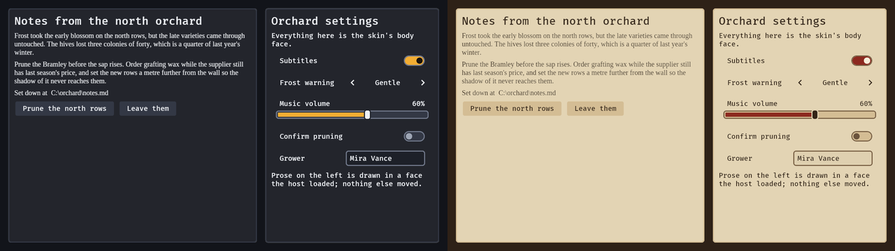

# One text, its own face

`GooeyFonts` holds the face every widget draws in: `body` for labels, `heading` for a heading, `mono` for
the code editor. A game that wants a second face for **one kind of text** — a page of prose in a reading
serif, a plate number in a condensed face, a level name in the game's display face — puts `TextFace` on
the texts it belongs to.

```rust
fn setup(mut commands: Commands, assets: Res<AssetServer>) {
    let reading = assets.load("fonts/reading.ttf");
    commands.spawn((
        panel(),
        children![
            heading("Notes from the north orchard"),
            (label("Frost took the early blossom."), TextFace::new(reading.clone())),
            (label("Everything else keeps the skin's face."),),
        ],
    ));
}
```

`TextFace(FontSource)` pins the face; the role still gives the text its **ink and its size**, and the
host's weight, slant, width and features are kept, so a bold run in a custom face stays bold. A
`FontSource` is a `Handle<Font>` you loaded, or a CSS font-family list as a string (`"'Fira Sans',
sans-serif"`), which Bevy resolves off the system, glyph by glyph.



## Why a component and not a field of the skin

`apply_skin` is the one writer of a widget's look, and it writes the face with the colours: a `TextFont`
a game sets on a widget is written over the next time the widget restyles — and a restyle is not rare
(a state change, a move, a skin change, a scope change, the first frame's real render target). A game that
wanted its own face ran a system after `GooeySystems::Style` re-applying it every frame: two writers of one
component, which is the defect the guide names for `SplitThickness` and the LED's glow.

A field of `GooeySkin` cannot be the answer either. The skin is one look for a whole screen, and the face
belongs to a *kind* of text: the crate cannot know which of a screen's labels is prose. So the face is a
component on the text, like `InkOverride` (where the host pins one part of a node's look and the skin writes
the rest).

- **Per node, no cascade.** A `TextFace` on a panel does not reach the text below it: a cascade would make a
  panel's face reach a Markdown page's spans and a code editor's glyphs, which are exactly the texts that
  must not take it (the editor measures one column from `GooeyFonts::mono`). Put it on the texts you draw.
- **Taking it off gives the role's face back** in the same frame (`Changed<TextFace>` and its removal are
  restyle triggers), so a reader's "plain face" option is one `remove::<TextFace>()`.
- **A settled text writes nothing**: the face is written once, not every frame.

## What it does not do

- A text the crate spawns for a widget — a button's words, a choice's option, a table's cell — takes its
  face from its role, and putting a `TextFace` on the widget itself does not reach those parts. Put it on
  the part (`Role::ButtonText` under a `button()`), or set `GooeyFonts::body` for the whole interface.
- A `TextSpan` under a Markdown paragraph carries its own face (the weight and slant the Markdown gives
  it); a `TextFace` on the paragraph does not reach it.
- The size stays the role's, snapped to whole device pixels at the interface scale, so a custom face
  cannot push a control out of the type grid ([large text](../guide/widgets.md) is held at every step).

## The example's second face

`examples/text_face.rs` draws a page of prose in a 9.7 KB subset of Liberation Serif (SIL OFL 1.1,
`assets/fonts/OFL.txt`; the crate itself supplies no font to a consumer) beside a settings panel in the
skin's face, so one still shows both. `cargo run --release --example text_face`, or capture it:

```sh
GOOEY_FRAMES=120 GOOEY_SHOT=text_face.png cargo run --release --example text_face
GOOEY_SKIN=parchment GOOEY_FRAMES=120 GOOEY_SHOT=text_face-parchment.png cargo run --release --example text_face
```
